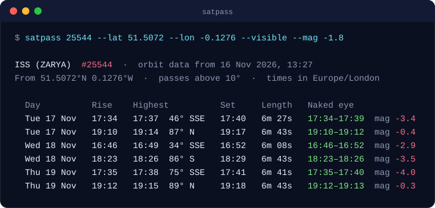

# satpass

**When can I see that satellite?** satpass predicts when a satellite passes
over you, where to look, whether it will be visible to the naked eye, and
roughly how bright it will be. It works in Node.js and in the browser, and
comes with a command-line tool.

[](https://github.com/Arax7X/satpass/actions/workflows/test.yml)
[](LICENSE)



<sub>Real output for London, 17 to 19 November 2026.</sub>

- **Accurate.** Rise, peak and set are found to a tenth of a second and
  [checked against Skyfield](#accuracy) on 172 passes.
- **Answers the real question.** Each pass says whether you can see it: the
  satellite has to be in sunlight while your sky is dark.
- **Short passes aren't missed.** A satellite that peeks above your horizon
  for less than a minute between search steps is still found.
- **Any orbit data.** TLE text (two or three lines) or CelesTrak's newer OMM
  JSON, which also works for catalog numbers above 99999.
- **Small.** One dependency ([satellite.js](https://github.com/shashwatak/satellite-js)), typed, ESM.

## Try it

Node.js 20 or newer:

```sh
npx github:Arax7X/satpass 25544 --lat 51.5072 --lon -0.1276 --visible
```

`25544` is the ISS's NORAD catalog number. Look up any other satellite's on
[CelesTrak](https://celestrak.org/satcat/search.php). Run `satpass --help` for every option.

## Use it in code

```sh
npm install github:Arax7X/satpass
```

```js
import { fetchTle, getPasses } from 'satpass'

const iss = await fetchTle(25544) // latest orbit data from CelesTrak
const london = { lat: 51.5072, lon: -0.1276 }

for (const pass of getPasses(iss, london, { days: 3, visibleOnly: true, stdMagnitude: -1.8 })) {
  const { start, end } = pass.visibility
  console.log(
    `${start.time.toLocaleString()}: look ${start.direction}, ` +
    `highest ${pass.peak.elevation.toFixed(0)}° ${pass.peak.direction}, ` +
    `gone at ${end.time.toLocaleTimeString()}, magnitude ${pass.magnitude.toFixed(1)}`,
  )
}
```

Already have the orbit data? Pass it straight in:

```js
import { getPasses } from 'satpass'

const passes = getPasses(`ISS (ZARYA)
1 25544U 98067A   26320.56058679  .00009493  00000+0  17760-3 0  9997
2 25544  51.6320 266.0553 0007390  32.4819 327.6623 15.49415609595374`, { lat: 40.7128, lon: -74.006 })
```

### In the browser

satpass itself is plain JavaScript, but satellite.js 7 ships an optional
WebAssembly engine that bundlers try to package. satpass never loads it; one
setting tells your bundler to leave it alone:

- **Vite:** add `worker: { format: 'es' }` to `vite.config.js`.
- **esbuild:** pass `--external:node:*`.

Both were tested in Chrome with Vite 8 and esbuild 0.28. The bundle is about
15 kB gzipped.

## API

### `getPasses(satellite, observer, options?)`

Returns an array of passes, in time order.

`satellite` is anything [`parseTle`](#parsetleinput-options) accepts.
`observer` is `{ lat, lon, alt }`: degrees north, degrees east, metres above
sea level (`alt` is optional).

| Option | Default | What it does |
| --- | --- | --- |
| `start` | now | Start of the search: a `Date`, a timestamp or an ISO string |
| `end` | `start` + `days` | End of the search |
| `days` | `1` | How many days to search when `end` is not given |
| `minElevation` | `10` | Lowest height above the horizon, in degrees, that counts as a pass |
| `maxSunElevation` | `-6` | The sky counts as dark when the Sun is lower than this |
| `visibleOnly` | `false` | Only return passes you can see with the naked eye |
| `stdMagnitude` | none | The satellite's standard magnitude, to estimate how bright it looks |
| `stepSeconds` | `30` | Search step; each pass is then refined to 0.1 s |
| `limit` | none | Stop after this many passes |

Each pass looks like this:

```js
{
  rise: { time, azimuth, elevation, direction, rangeKm },  // climbs above minElevation
  peak: { time, azimuth, elevation, direction, rangeKm },  // highest point
  set:  { time, azimuth, elevation, direction, rangeKm },  // drops below minElevation
  duration: 387,                // seconds from rise to set
  visible: true,                // can you see it with the naked eye?
  visibility: { start, end },   // the stretch you can see it, or null
  magnitude: -3.4,              // brightest estimate, or null
  brightest: { time, azimuth, elevation, direction, rangeKm, magnitude },
}
```

Azimuth is in degrees clockwise from north (90 is east), and `direction` is
the same as a compass point such as `SSE`. A pass that is already under way
at `start` is included, so its `rise.time` can be earlier than `start`.

A geostationary satellite never rises or sets, so it has no passes; use
`observe` to see where it is in your sky.

### `observe(satellite, observer, time?, options?)`

Where the satellite is in your sky at one moment: `azimuth`, `elevation`,
`direction`, `rangeKm`, whether it is `sunlit`, the Sun's elevation
(`sunElevation`) and whether it is `visible`. Pass `{ stdMagnitude }` to
get a `magnitude` too.

### `getPosition(satellite, time?)`

The point on Earth below the satellite (`lat`, `lon`), its height (`altKm`)
and its speed (`speedKmS`).

### `parseTle(input, options?)`

Reads orbit data and returns `{ name, id, epoch, satrec }`. It accepts TLE
text with two or three lines, an array of lines, `{ name, line1, line2 }`, a
CelesTrak OMM JSON record, or a satellite.js satrec. Each TLE line's checksum
is verified, so a line that was copied incompletely fails with a clear
message instead of giving wrong passes. Pass `{ verifyChecksum: false }` to
skip that.

`epoch` is when the orbit data was measured. Predictions drift as it ages, so
use data that is a few days old at most.

### `fetchTle(id, options?)`

Downloads the latest orbit data for one satellite from
[CelesTrak](https://celestrak.org) by its catalog number. CelesTrak sends no
CORS headers, so in a browser pass `{ baseUrl }` pointing at your own proxy
([Orbit Core has one](https://github.com/Arax7X/orbit-core/blob/main/api/celestrak.js)).
Please cache what you download: CelesTrak updates its data a few times a day
and blocks clients that ask too often.

## Accuracy

`test/skyfield.test.js` compares satpass with
[Skyfield](https://rhodesmill.org/skyfield/), a separate and widely used
astronomy library, on 172 passes: the ISS, the Chinese space station, Hubble
and a Starlink satellite over London, New York, Sydney, Quito and Tromsø,
across three days. The largest differences:

| | Largest difference |
| --- | --- |
| Rise and set times | 0.35 s |
| Time of highest point | 0.12 s |
| Highest elevation | 0.007° |
| Start and end of naked-eye visibility | 1.2 s (Skyfield was sampled once a second) |
| Visible or not | the same on every pass |

`scripts/skyfield_reference.py` rebuilds that reference.

Like most pass predictors, satpass uses geometric elevation without
atmospheric refraction, and the shape of the Earth from WGS-84. The biggest
source of error in practice is old orbit data, not the calculation.

### How bright?

Brightness is an estimate. It starts from the satellite's standard magnitude
(how bright it is at 1000 km when half lit), then adjusts for the real
distance, the angle of sunlight, and partial shadow near the edge of the
Earth's shadow. It ignores the dimming of the atmosphere near the horizon and
the satellite's actual shape. Published standard magnitudes for the ISS range
from about −1.3 to −2.0. Lower numbers are brighter: the brightest stars are
around 0, and the faintest you can see from a dark site are around 6.

## How it works

1. [SGP4](https://celestrak.org/publications/AIAA/2006-6753/) (through
   satellite.js) works out where the satellite is every 30 seconds.
2. Each time it crosses `minElevation`, bisection pins the moment down to
   0.1 s. Peaks are found with a golden-section search, which also catches
   passes too short to show up between two samples.
3. Sunlight on the satellite comes from the Sun's position and the cone of
   the Earth's shadow. The satellite counts as sunlit while the centre of the
   Sun is not hidden behind the Earth.
4. Your sky counts as dark once the Sun is 6° below the horizon, the end of
   civil twilight.

## Credits

Orbit data from [CelesTrak](https://celestrak.org). Orbit propagation by
[satellite.js](https://github.com/shashwatak/satellite-js). Checked against
[Skyfield](https://rhodesmill.org/skyfield/).

Made by [Anastacia](https://github.com/Arax7X), who also builds
[Orbit Core](https://github.com/Arax7X/orbit-core), a live 3D globe of every
active satellite.

## Licence

MIT
